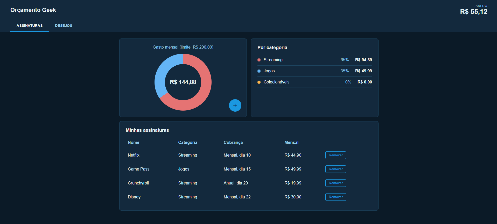
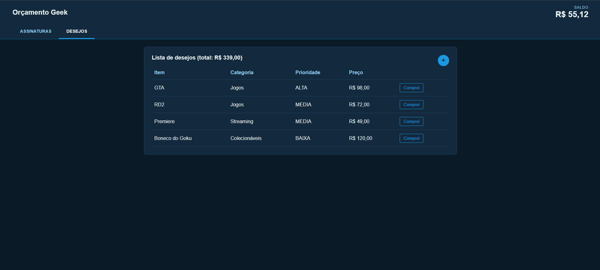

# Orçamento Geek




Projeto para controlar os gastos com entretenimento: assinaturas (Netflix, Game Pass, Spotify...) e uma lista de desejos de jogos, filmes e colecionáveis. A página mostra o gasto mensal e avisa quando ele passa do limite que eu defini.

## Funcionalidades

- Listar, adicionar e remover assinaturas
- Cálculo do gasto mensal (assinaturas anuais são divididas por 12)
- Alerta quando o gasto passa do limite mensal
- Gasto por categoria, com gráfico de rosca
- Listar itens da lista de desejos por prioridade, adicionar e marcar como comprado

## Tecnologias

- Java (JDBC e `HttpServer`, sem framework)
- MySQL
- HTML, CSS e JavaScript
- Maven

## Estrutura do projeto

```
OrcamentoDeStreamings/
  banco/
    script.sql          criação das tabelas e dados de exemplo
  src/main/java/org/example/
    Assinatura, ItemWishlist, Categoria      classes do modelo
    AssinaturaDAO, ItemWishlistDAO,
    CategoriaDAO, LimiteDAO                  acesso ao banco (JDBC)
    Conexao                                  conexão com o MySQL
    Servidor                                 servidor HTTP que devolve JSON
  web/
    index.html, estilo.css, app.js           página do projeto
  pom.xml
```

## Como rodar

Você precisa de: JDK (o projeto foi feito com o JDK 26), MySQL e a extensão Live Server do VS Code.

1. Clone o repositório:
```
   git clone https://github.com/Phvazzoler/OrcamentoDeStreamings.git
```
2. No MySQL Workbench, abra e execute o arquivo `banco/script.sql`. Ele cria o banco `orcamento_streamings`.
3. Defina a variável de ambiente `DB_SENHA` com a senha do seu MySQL. No IntelliJ: **Run > Edit Configurations > Environment variables** e escreva `DB_SENHA=sua_senha`.
4. Rode o `main` da classe `Servidor`. Ele sobe na porta 8080.
5. Abra o `web/index.html` com o Live Server.

A senha do banco não fica escrita no código, por isso a variável de ambiente.

## Rotas do servidor

| Método | Rota | O que faz |
|---|---|---|
| GET | `/api/resumo` | Devolve limite, gasto, categorias, assinaturas e desejos em JSON |
| POST | `/api/assinaturas` | Adiciona uma assinatura |
| POST | `/api/desativar?id=` | Remove (desativa) uma assinatura |
| POST | `/api/wishlist` | Adiciona um item na lista de desejos |
| POST | `/api/comprar?id=` | Marca um item como comprado |

## O que eu pratiquei

- Modelagem de banco de dados com chaves primárias e estrangeiras
- CRUD com JDBC e o padrão DAO
- Servidor HTTP simples em Java
- Consumo da API com `fetch` no JavaScript
- Guardar senha fora do código

## Ideias para depois

- Editar uma assinatura que já existe
- Cadastrar o limite mensal pela página
- Gráfico de gastos por mês

## Autor

Pedro Vazzoler

- GitHub: [Phvazzoler](https://github.com/Phvazzoler)
- LinkedIn: [pedro-vazzoler](https://linkedin.com/in/pedro-vazzoler)