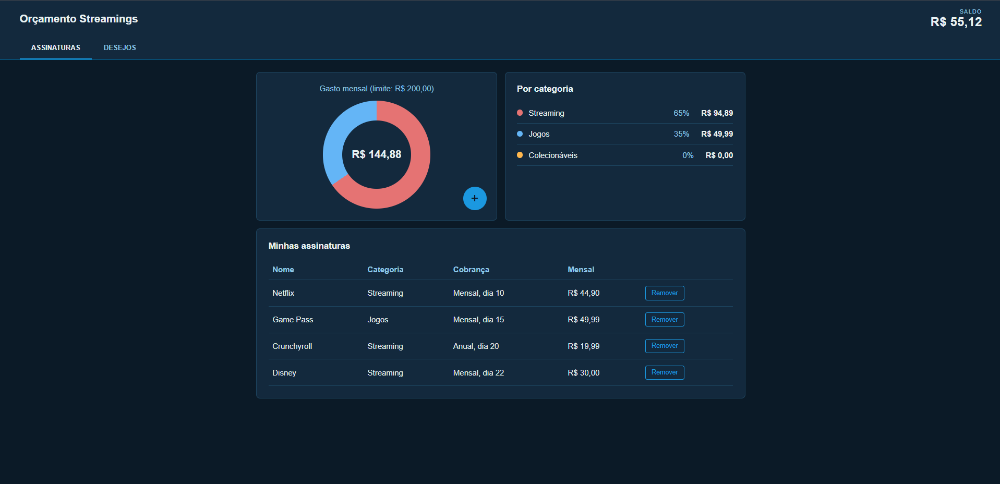
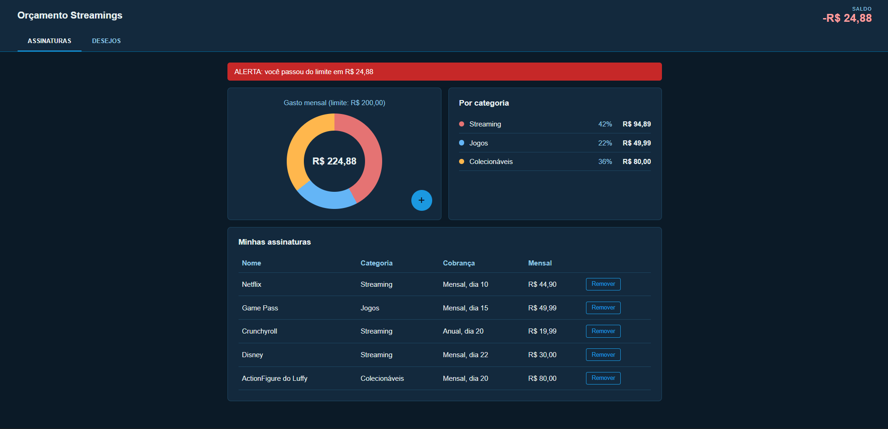
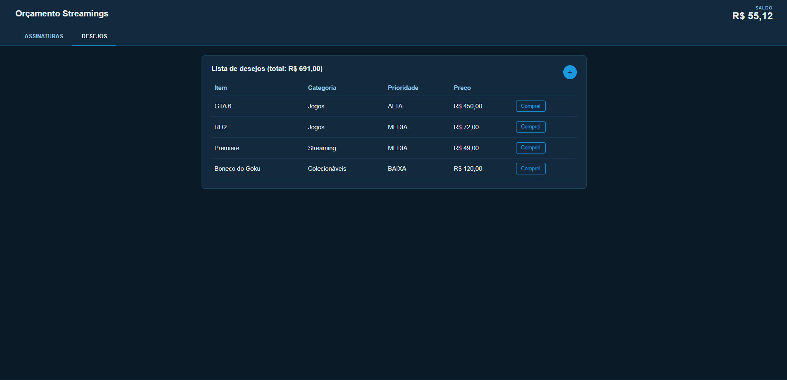

# Orçamento Streamings







Projeto para controlar os gastos com entretenimento: assinaturas (Netflix, Game Pass, Spotify...) e uma lista de desejos de jogos, filmes e colecionáveis. A página mostra o gasto mensal e avisa quando ele passa do limite que eu defini.

## Funcionalidades

- Listar, adicionar e remover assinaturas
- Cálculo do gasto mensal (assinaturas anuais são divididas por 12)
- Alerta quando o gasto passa do limite mensal
- Gasto por categoria, com gráfico de rosca
- Listar itens da lista de desejos por prioridade, adicionar e marcar como comprado

## Tecnologias

- Java (JDBC e `HttpServer`, sem framework)
- MySQL
- HTML, CSS e JavaScript
- Maven

## Estrutura do projeto

```text
OrcamentoDeStreamings/
│
├── banco/
│   └── script.sql
│
├── src/
│   └── main/
│       └── java/
│           └── org/
│               └── example/
│                   ├── Assinatura.java          # Modelo de assinatura
│                   ├── ItemWishlist.java        # Modelo de item da wishlist
│                   ├── Categoria.java           # Modelo de categoria
│                   │
│                   ├── AssinaturaDAO.java       # Acesso ao banco (JDBC)
│                   ├── ItemWishlistDAO.java     # Acesso ao banco (JDBC)
│                   ├── CategoriaDAO.java        # Acesso ao banco (JDBC)
│                   ├── LimiteDAO.java           # Acesso ao banco (JDBC)
│                   │
│                   ├── Conexao.java              # Conexão com o MySQL
│                   └── Servidor.java             # Servidor HTTP, frontend e API
│
├── FRONT/
│   ├── index.html                 # Estrutura da página
│   ├── CSS/
│   │   └── style.css              # Estilização da página
│   ├── JS/
│   │   └── script.js              # Funcionalidades do frontend
│   └── PrintPag/                  # Imagens do projeto
│
└── pom.xml                        # Configurações e dependências do Maven
```

## Como rodar

Você precisa de: JDK 26, MySQL, MySQL Workbench e IntelliJ IDEA Community.

1. Clone o repositório:

```bash
git clone https://github.com/Phvazzoler/OrcamentoDeStreamings.git
```

2. No MySQL Workbench, abra e execute o arquivo `banco/script.sql`. Ele cria o banco `orcamento_streamings`.

3. Defina a variável de ambiente `DB_SENHA` com a senha do seu MySQL. No IntelliJ: **Run > Edit Configurations > Environment variables** e escreva `DB_SENHA=sua_senha`.

4. Na configuração de execução da classe `Servidor`, defina o campo **Working directory** como `$PROJECT_DIR$`.

5. Rode o `main` da classe `Servidor`. Ele inicia o servidor na porta 8080.

6. Abra o navegador e acesse:

```text
http://localhost:8080/
```

A página será carregada diretamente pelo servidor Java, sem precisar do Live Server do VS Code.

A API também pode ser acessada pelo endereço:

```text
http://localhost:8080/api/resumo
```

A senha do banco não fica escrita no código, por isso a variável de ambiente.

## Rotas do servidor

| Método | Rota | O que faz |
|---|---|---|
| GET | `/` | Abre a página principal do sistema |
| GET | `/api/resumo` | Devolve limite, gasto, categorias, assinaturas e desejos em JSON |
| POST | `/api/assinaturas` | Adiciona uma assinatura |
| POST | `/api/desativar?id=` | Remove (desativa) uma assinatura |
| POST | `/api/wishlist` | Adiciona um item na lista de desejos |
| POST | `/api/comprar?id=` | Marca um item como comprado |

## O que eu pratiquei

- Modelagem de banco de dados com chaves primárias e estrangeiras
- CRUD com JDBC e o padrão DAO
- Servidor HTTP simples em Java
- Criação de rotas para disponibilizar o frontend e a API
- Consumo da API com `fetch` no JavaScript
- Integração entre Java, MySQL e frontend
- Guardar senha fora do código

## Ideias para depois

- Editar uma assinatura que já existe
- Cadastrar o limite mensal pela página
- Gráfico de gastos por mês

## Autor

Pedro Vazzoler

- GitHub: [Phvazzoler](https://github.com/Phvazzoler)
- LinkedIn: [pedro-vazzoler](https://linkedin.com/in/pedro-vazzoler)
